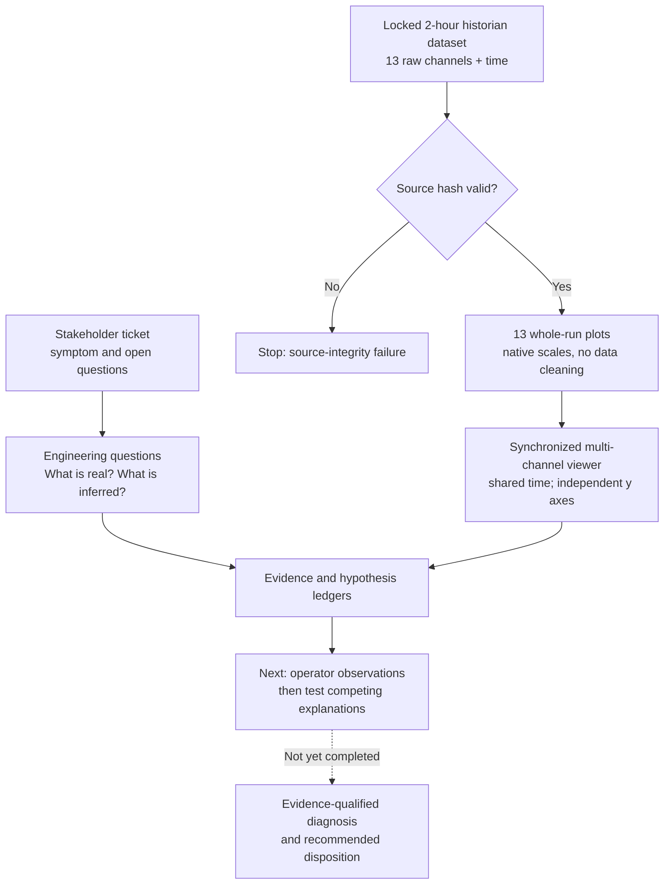

# CK-17 — Evidence-Led Engineering Investigation

> **Status: Active / blinded investigation.** The data-preparation and visualization stages are documented; **no root cause, equipment diagnosis, or run/hold decision has been accepted**. This is a synthetic engineering scenario, not an employer or customer incident.

## At a Glance

**Problem:** A stakeholder reports that an industrial cooling skid's circulation pump appears to work harder during longer runs without a proportionate increase in process load. The shorthand description is that the pump is "losing capacity." No pump trip or controller fault is reported. An automated historian summary flags a possible anomaly, but that summary is **not** accepted as a diagnosis.

**Objective:** Independently investigate whether the recorded evidence supports a real performance loss, an equipment/control/instrumentation concern, an operating-condition explanation, or a narrower conclusion. Recommend whether to rerun, inspect, or hold only when the available evidence justifies it.

**Progress:** The original dataset was locked as read-only evidence; the stakeholder ticket and provenance record were established; 13 channel-by-channel overview plots and an interactive synchronized viewer were created. The viewer was subsequently generalized as a reusable analysis tool. **Interpretation, competing-hypothesis testing, disposition, and blind validation remain open.**

This project demonstrates the investigation process *while it is happening*, including the decision to build tooling before making an unsupported causal claim.

## System and Investigation Context

CK-17 is a fictional industrial liquid-cooling skid circulating approximately 30% glycol/water. The stated system includes:

- a variable-speed centrifugal circulation pump;
- a modulating bypass valve;
- a heat exchanger;
- an atmospheric reservoir;
- PLC controls and recorded process signals.

The scenario supplies a **two-hour endurance-run historian export**: 3,601 timestamped rows with nominal 2-second sampling, containing 13 recorded non-time channels.

The available signal families include process load, flow target and measurement, pump command/speed/current, supply and return pressure, supply and return temperature, bypass command, reservoir level, and ambient temperature.

These are **signals and system elements**, not proof that any particular component failed. The exact physical piping topology is not represented by the diagram below.

## Architecture: From Evidence to Decision

**Control principle:** A stakeholder statement, raw reading, derived calculation, AI suggestion, and accepted engineering conclusion are different kinds of evidence. They must not be silently promoted into one another.

## Requirements and Guardrails

| Constraint | Implemented approach |
|---|---|
| Preserve source truth | Copy the released CSV byte-for-byte, verify SHA-256, and keep the working source read-only |
| Prevent invisible data alterations | Write any transformed or corrected data to separate, traceable derived artifacts |
| Preserve the stakeholder's original question | Record the source ticket as its own evidence item; log clarifications separately |
| Keep AI non-authoritative | AI can help prepare plots and interpretations; final acceptance remains with the investigator |
| Do not bias the result | Keep the scenario's hidden generating explanation and answer key outside the investigation workflow |
| Separate observation from causation | Maintain evidence and hypothesis ledgers, including rejected explanations and uncertainty |
| Avoid premature repair decisions | Require an explicit, evidence-supported basis for rerun / inspect / hold recommendations |

The locked dataset and hidden answer key were established before the investigation. Neither is modified to make a later theory look successful.

## Work Completed So Far

### 1. Establish a source-integrity baseline

Before interpreting channels, the source dataset was positively matched to its recorded SHA-256 and copied into a read-only working area. The investigative rule is **no in-place cleaning, sorting, filling gaps, or overwriting**. Future corrections must become independently named derived evidence.

This prevents a common investigation failure: losing the distinction between what the instrument actually recorded and what an analyst later wished it had recorded.

### 2. Make a raw, whole-run first pass

The first visualization request used time on the X axis and each of the 13 other recorded channels on its **own native Y scale**, covering the full run.

**Recorded result:** 13 separate plots, with no smoothing, filtering, normalization, resampling, interpolation, outlier removal, or missing-value repair. This is a visualization output, **not** a recorded diagnosis.

### 3. Build the tool the investigation needed

Separate plots were insufficient for rapidly checking whether events in different signals coincided. The next requirement was a synchronized display familiar to engineers working with recorder-style data:

- 13 vertically stacked channel tracks sharing the same time axis;
- synchronized zoom and pan;
- independent, adjustable Y ranges per signal;
- show/hide controls for individual traces;
- preservation of raw channel values without normalization.

A working interactive HTML viewer was generated, with its provenance and artifact hash recorded. The idea was then extracted into a **reusable aligned-channel viewer**, rather than left as a one-off scenario script. Its optional SHA-256 gate refuses to analyze a source whose bytes do not match the expected dataset.

The viewer improves *inspection* of timing relationships; it does not, by itself, establish numerical causality or repair bad measurements.

### 4. Preserve an auditable reasoning trail

The working evidence ledger records source class, question, time window, transformation, generated artifact, result, limitations, dependencies, and the investigator's acceptance status.

| Evidence stage | Record | Status |
|---|---|---|
| Source identity and working lock | E-000 / E-001 | Established |
| Stakeholder ticket | E-002 | Captured |
| Whole-run raw plots | E-003 | Generated |
| Synchronized channel viewer | E-004 | Generated; reusable tool promoted |
| First accepted time-domain observations | Not yet recorded | Pending |
| Tested root-cause hypothesis and disposition | Not yet accepted | Pending |

Some preparatory evidence entries still have **acceptance pending** in the private working ledger. Creating an artifact is not the same as accepting every interpretation of it.

## Current Investigative Questions

The next analytical pass will examine the time relationships among requested and measured flow, pump effort, pressure differential, bypass demand, temperatures, process load, and reservoir behavior—without presuming that a correlated change identifies a cause.

Questions still to resolve include:

1. Does the measured behavior independently support the reported loss of capacity or cooling performance?
2. Could apparent changes arise from control action, sensor quality, system operating conditions, or equipment behavior?
3. Which conclusions survive a review of missing/stale samples and instrument limitations?
4. What additional test or stakeholder clarification would discriminate between competing explanations?
5. Is rerunning appropriate, or does the evidence first warrant inspection or calibration?

**No answer to those questions has been accepted yet.** The hidden answer key remains excluded.

## Verification and Reproducibility

The current evidence consists of a source-integrity record, a stakeholder ticket, independent whole-run plot artifacts, a synchronized viewer artifact, and their provenance entries. The viewer's reusable source and usage instructions are preserved privately.

The completed checks demonstrate that the original source was matched and kept separate from the views derived from it. They do **not** establish that the industrial symptom has been diagnosed, that a proposed remedy would succeed, or that the investigation has passed blind validation.

For future replay, the source identity and transformation instructions are retained so visualization artifacts can be regenerated without altering original evidence. No private dataset or answer key is published here.

## Next Steps and Acceptance Criteria

1. Reopen the synchronized viewer at a desktop-sized display.
2. Record the investigator's **first time-aligned observations** before AI-suggested interpretations.
3. Enter competing hypotheses and their supporting/contradicting evidence into the hypothesis ledger.
4. Calculate derived metrics only where they discriminate between explanations; preserve formulas and source lineage.
5. Identify the limits of the instrumentation and decide which additional observation or test is justified.
6. Submit a provisional recommendation, then perform the planned **blind validation** against the held-back scenario truth.

The final case study will distinguish correct conclusions, mistakes, blind spots, and useful rejected hypotheses rather than retroactively presenting a perfectly linear success story.

## What It Demonstrates So Far

This is intentionally an **in-progress** example of transferring engineering investigation habits into an AI-assisted workflow: protecting source data, separating facts from theories, developing useful exploratory tools, defining acceptance authority, and preserving the steps by which a conclusion eventually earns confidence.

One concrete outcome has already emerged: a reusable synchronized engineering trace viewer arose from investigation friction, rather than from building software for its own sake.

## Disclosure and Limitations

CK-17 and its historical run are synthetic. Its private dataset, generator, answer key, and detailed investigation ledger are withheld to preserve the blind experiment and protect the integrity of subsequent analysis. The public description is a sanitized progress report, not a certification report or an assertion of an actual industrial equipment failure.
