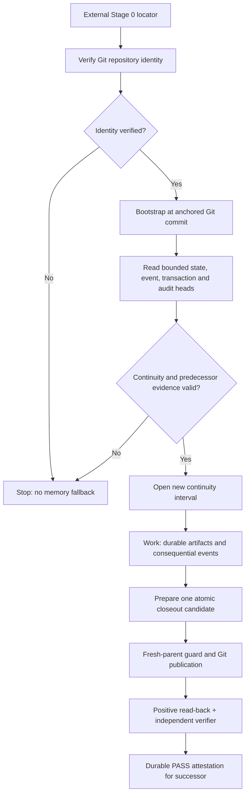

# Persistent AI Systems — Verified State and Recovery

> **Status:** Implemented and exercised in a private hosted-AI prototype. This public case study and demonstrator are sanitized; they are not a release of the private canonical system.

## At a Glance

**Problem:** Long-running AI projects lose reliable operational context when a chat session ends, a tool call fails, or a different model instance resumes the work. A plausible answer about prior state is not enough to establish that it is *correct*.

**Solution:** I developed a Git-backed continuity architecture that separates the reasoning model from authoritative project state. A fresh session verifies an external locator, reconstructs from a bounded set of canonical records, and refuses to proceed when required integrity or predecessor-continuity evidence is missing. The system prepares logically related closeout records together, publishes through a guarded Git commit, and relies on an independent verifier rather than a model's statement that a write succeeded.

**Observed outcome:** Isolated-session reconstruction and cross-session handoff passed after an initial discovery failure. Separate fault-injection tests demonstrated safe behavior for unpublished commits, stale writers, ambiguous publication acknowledgments, and duplicate-operation retries. A GitHub Actions verifier independently checks continuity invariants and publishes an attestation for accepted closeouts.

The engineering goal is **auditable functional continuity**, not a claim that the same LLM computation runs continuously.

## Requirements and Design Constraints

1. Recover the current project status, constraints, unresolved work, and next resume point after a session boundary.
2. Treat one positively identified Git repository and branch as authority; prior conversation and model memory are supplemental, not fallback authority.
3. Preserve decisions, experiment outcomes, architectural changes, and relevant provenance as inspectable artifacts and immutable consequential events.
4. Keep ordinary startup work bounded even as history grows; avoid reconstructing an entire event ledger on each boot.
5. Publish related event, transaction, audit, and state changes as one guarded logical update, not independent partial commits.
6. Detect interrupted writes, stale parents, duplicate logical operations, mismatched hashes, and incomplete attestations.
7. Fail closed on unresolved authority or integrity conflicts; separate advice and generated text from verified state transitions.

## Architecture



The diagram summarizes the normal successful path. A failed publication, invalid attestation, or ambiguous tool response enters explicit reconciliation rather than being silently treated as success.

### 1. Discover and verify authority

A small **Stage 0 locator** names the expected source. It does not contain operational project state. The fresh instance positively verifies repository identity, retrieves the bootstrap contract, and anchors reconstruction to a particular Git commit before reading state.

This resolved a real circular dependency: the earliest reconstruction instructions lived in the repository the new session did not yet know how to find.

### 2. Reconstruct from bounded roots

The active design uses small, directly addressable records for boot-critical state, event position, the current continuity transaction, its audit record, and—when required—the predecessor's independent verification attestation.

Full historical artifacts remain available for investigation without being required on every startup.

**Design invariant:** History can grow without bound; the current authority-reconstruction workload should remain bounded.

### 3. Separate durability from continuity

Not every useful conversation needs a Git commit, and not every durable file change is a complete cross-session checkpoint.

| Level | Meaning | Example |
|---|---|---|
| **D0** | Provisional working discussion | A proposed idea or hypothesis |
| **D1** | Durable, read-back-verified artifact | An accepted experiment or design record |
| **D2** | Reconciled continuity state | Matching session, event, transaction, state, and verification evidence |

A fresh session must not confuse partial durable work with a fully verified predecessor closeout.

### 4. Publish with explicit transaction boundaries

At closeout, consequential results are reconciled, immutable event records and state projections are prepared, and a deterministic builder constructs the audit record and cryptographic bindings.

Preparation creates Git objects but does **not** advance the canonical branch. Immediately before publication, the writer rechecks the expected parent. One non-forced branch update publishes the complete logical mutation, followed by positive read-back and independent verification.

If the response to publication is missing or ambiguous, the system inspects canonical Git state and the stable operation identity before deciding whether any retry is safe. Blind retries are not allowed.

### 5. Require independent attestation

The verification workflow tests the deterministic audit builder, independently checks continuity relationships and hashes, and records durable PASS evidence for valid completed transactions. The next session checks the predecessor's matching attestation instead of relying on a chat summary or an optimistic success message.

The model **proposes and interprets**. Git records authority; deterministic code and independent verification decide whether the continuity evidence agrees.

## Failures That Changed the Design

| Failure / test condition | What it exposed | Engineering response |
|---|---|---|
| Fresh session could not locate canonical state | Bootstrap instructions were hidden behind their own discovery dependency | Introduced the external Stage 0 locator and positive repository-identity check |
| Incomplete closeout produced a stale resume point | Several successful writes did not imply a complete continuity checkpoint | Defined durability levels, coherent closeout records, and successor verification |
| Historical event ledger was truncated by a write | “Append-only” as an intention was insufficient | Strengthened immutable records, positive read-back, and deterministic ledger/state checks |
| Prepared commit interrupted before branch publication | Git objects can exist without being authoritative | Demonstrated that unpublished candidates remain invisible; recover from the published head |
| Stale writer attempted to publish from an old parent | Concurrent authors can otherwise overwrite a newer lineage | Required a fresh-parent guard and non-forced publication |
| Publication acknowledgment was treated as lost | Tool responses do not determine whether a commit exists | Reconstructed the result from Git lineage, operation identity, and state read-back |
| Duplicate logical operation retry | A second append could duplicate an already completed action | Added operation-ID reconciliation and uniqueness verification |

These are development and regression results, not a claim that every possible failure mode has been eliminated.

## Verification Evidence

The private project has been tested through progressively more realistic boundaries:

- **Fresh-session discovery and recovery:** after the initial failure, an isolated successor verified the source, reconstructed the operating state, and completed a cross-session handoff. See the [sanitized discovery failure record](evidence/fresh-session-discovery-failure.md).
- **Git fault injection:** an intentionally unpublished candidate remained invisible; a stale writer was rejected; lost-acknowledgment recovery and duplicate-operation prevention were exercised on isolated branches.
- **Deterministic integrity:** continuity audits bind transaction snapshots and predecessor records with SHA-256. Regression tests deliberately corrupt hashes or transaction relationships to confirm rejection.
- **Independent GitHub verification:** an automated workflow checks the published continuity state and persists matching PASS attestations. A successful API response alone is not accepted as verification.
- **Recent development hardening:** a bounded one-pass closeout preparation procedure was independently safety-reviewed and tested with isolated Git interruption/recovery scenarios. Its end-to-end latency improvement was **not established** by those tests.

The tests are scoped to the actual hosted Git/GitHub workflow. They do not establish uninterrupted operation, unlimited transcript recovery, or behavioral equivalence across arbitrary models.

## Try the Sanitized Demonstrator

The public `demo/` folder is a deliberately reduced illustration of the trust boundary, not a clone of the full private runtime.

- [Locator example](demo/locator.example.json): source addressing without project state.
- [Bootstrap example](demo/bootstrap.example.md): source verification and fail-closed reconstruction rules.
- [State example](demo/state.example.json) and [event log](demo/event_log.example.jsonl): synthetic continuity artifacts.
- [Manifest](demo/manifest.example.json) and [snapshot verifier](demo/verify_snapshot.py): simple SHA-256 and event-tail checks.

From the project directory:

```bash
python demo/verify_snapshot.py
```

The example verifier checks the listed file hashes, duplicate event IDs, and agreement between the state pointer and event-log tail. **It does not implement the private V2.1 audit chain, atomic publisher, or GitHub attestation workflow.**

## Engineering Approach and Transferable Skills

This was an AI-assisted engineering project, with human-controlled requirements, architecture decisions, failure review, authorization, and acceptance. I used the same habits I developed in mechanical and test engineering: define what must be observable, instrument failure points, separate inferred state from measured evidence, test recovery paths, and refuse to call a condition verified until it has a positive postcondition.

The work demonstrates:

- systems decomposition and boundary design;
- model-independent state and provenance architecture;
- optimistic concurrency and transaction reasoning;
- fault-injection and regression-driven validation;
- human-governed AI integration and clear authority limits;
- technical documentation that connects decisions to evidence.

## Boundaries and Next Work

This is a **working hosted continuity system**, not a claim of conscious or continuously running AI. The reasoning model can be replaced, but equivalence of different models is not assumed. Source-native conversation capture and archive reconciliation remain separate problems; the model cannot guarantee access to every prior conversational turn.

The private architecture also does not mean that the public demonstrator is production-ready or contains all of the system's controls. Future work includes measuring complete closeout latency under ordinary workloads, validating broader model/runtime migrations, and moving timekeeping and operational state into a local persistent control layer.

## Publication and Confidentiality

The source implementation and canonical project history remain private. This portfolio preserves sanitized engineering evidence, a limited demonstrator, and the reasoning behind key design choices without publishing credentials, private project content, or unrelated personal and workplace data.
